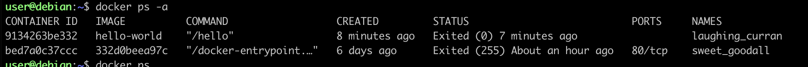
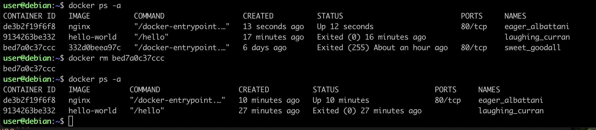
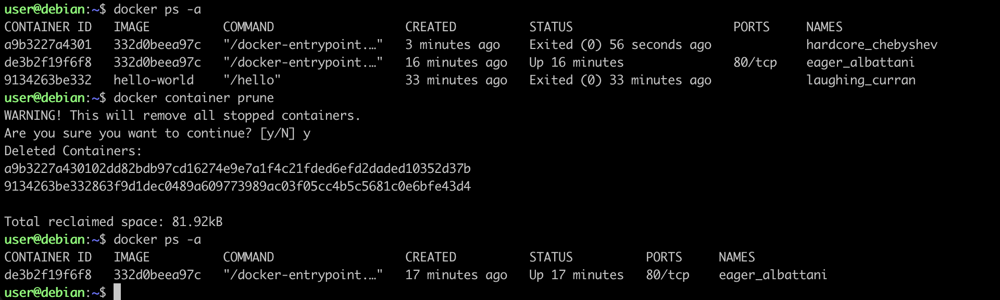

# Nginx

**Nginx** (произносится как «энджинкс») — это популярное бесплатное программное обеспечение с открытым исходным кодом, которое работает как веб-сервер, обратный прокси-сервер (reverse proxy) и почтовый прокси-сервер. <br>
Официальный образ nginx лежит в Docker Hub.


## Задание
- Возьмем официальный докер-образ с nginx и выкачать его при помощи docker pull. Скачается версия по умолчанию latest.<br>
В зависимости от ОС (Linux, MacOS и т.д.) можно запускать по разному.<br>
 1. Если Linux запускается командой:
  ```docker run```
  ```systemctl status docker``` - проверка, запущен ли докер.
 2. Если MacOs (Window):
  - запускаем приложение Docker.
  
- docker run - создает каждый раз новый контейнер из образа и запускает его. Это составная команда — по сути docker create + docker start. Если образа нет локально — неявно делает pull. Результат виден в docker ps <br>

- docker pull nginx = docker pull nginx:latest - скачивает образ nginx.

- docker start <id> - запуск существующего контейнера

- Проверим наличие докер-образа через docker images:
 ```docker images```


- docker ps -a - выводит все контейнеры и запущенные и остановленные.
```docker ps -a```


- docker rm <name, id> - удаление остановленного контейнера.
```docker rm <name, id>```


- docker container prune - удалить все остановленные контейнеры
```docker container prune```

