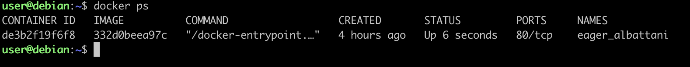

# Nginx

**Nginx** (произносится как «энджинкс») — это популярное бесплатное программное обеспечение с открытым исходным кодом, которое работает как веб-сервер, обратный прокси-сервер (reverse proxy) и почтовый прокси-сервер. <br>
Официальный образ nginx лежит в Docker Hub.


## Задание
1. Возьмем официальный докер-образ с nginx и выкачать его при помощи docker pull. Скачается версия по умолчанию latest.<br>
Также рассмотрим несколько основных команд для работы с докером. <br>
В зависимости от ОС (Linux, MacOS и т.д.) можно запускать по разному.<br>
  1.1. Если Linux запускается командой:
  ```docker run```<br>
  ```systemctl status docker``` - проверка, запущен ли докер.
  1.2. Если MacOs (Window):
  - запускаем приложение Docker.
  
- ```docker run``` - создает каждый раз новый контейнер из образа и запускает его. Это составная команда — по сути docker create + docker start. Если образа нет локально — неявно делает pull. Результат виден в docker ps <br>

- ```docker pull nginx``` = docker pull nginx:latest - скачивает образ nginx.

- ```docker start <id>``` - запуск существующего контейнера


- Проверим наличие докер-образа через docker images: <br>
 ```docker images```


- ```docker ps -a``` - выводит все контейнеры и запущенные и остановленные.


- ```docker rm <name, id>``` - удаление остановленного контейнера.


- ```docker container prune``` - удалить все остановленные контейнеры


- ```docker stop <name, id>``` - остановка докер контейнера. В статусе будет ```Exited (0) 16 min ago``` - если контейнер остановился правильно, без ошибки. <br>
```Exited (255) About an hour ago``` - контейнер остановится с ошибкой, например при перезагрузке виртуальной машины.


Разберемся, какую информацию несет с собой столбец при выводе командой ```docker ps/ps -a```


```CONTAINER ID``` - уникальный идентификатор контейнера — первые 12 символов от полного 64-символьного sha256-ID. Полный ID можно увидеть через docker ps --no-trunc. Именно этот ID (или имя) вы используете в docker stop, docker inspect, docker rm и т.д.

```IMAGE``` - из какого образа создан контейнер. В нашем случае nginx. Он тоже может быть указан

```COMMAND``` - команда, которая запущена внутри контейнера. Полную команду видно через docker ps --no-trunc или в docker inspect. У официального nginx-образа это /docker-entrypoint.sh nginx -g 'daemon off;' — скрипт-обёртка, которая настраивает окружение и запускает nginx в foreground-режиме (чтобы контейнер не завершался сразу).

```CREATED``` - когда контейнер был создан. Контейнер живёт с момента docker run — даже если вы его останавливали и запускали снова, CREATED не меняется.

```STATUS``` - текущее состояние контейнера:
- Up X seconds — запущен и работает X времени с последнего старта.
- Exited (0) 5 minutes ago — остановлен 5 минут назад с кодом 0.
- Restarting (1) 2 seconds ago — перезапускается (упал и Docker пытается поднять снова).
- Up 6 seconds (health: starting) — если настроен HEALTHCHECK, показывает статус здоровья.

```PORTS``` - порты контейнера. Важно: здесь 80/tcp без стрелочки -> — это значит, что порт 80 открыт внутри контейнера, но НЕ проброшен на хост. Снаружи (с вашего Mac, с других машин) к этому nginx достучаться нельзя. Чтобы был проброс, нужно запускать с -p 80:80, и тогда в колонке появится: ```0.0.0.0:80->80/tcp, :::80->80/tcp```

```NAMES``` - имя контейнера. Docker придумал его автоматически (случайная пара «прилагательное_фамилия»). Если бы вы запускали с --name my-nginx, здесь было бы my-nginx. Имя удобно для команд: docker stop eager_albattani вместо длинного ID. Имена уникальны — второй контейнер с тем же именем создать нельзя.

2. Посмотрим информацию о контейнере через ```docker inspect [container_id|container_name]```
