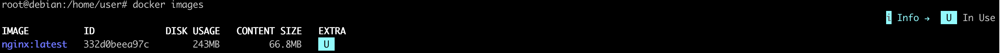

# Nginx

**Nginx** (произносится как «энджинкс») — это популярное бесплатное программное обеспечение с открытым исходным кодом, которое работает как веб-сервер, обратный прокси-сервер (reverse proxy) и почтовый прокси-сервер. <br>
Официальный образ nginx лежит в Docker Hub.


## Задание
- Возьмем официальный докер-образ с nginx и выкачать его при помощи docker pull. Скачается версия по умолчанию latest.<br>
В зависимости от ОС (Linux, MacOS и т.д.) можно запускать по разному.<br>
 - Если Linux запускается командой:
  ```docker run```
  ```systemctl status docker``` - проверка, запущен ли докер.
 - Если MacOs (Window):
  - запускаем приложение Docker;
  - docker run
docker pull nginx = docker pull nginx:latest - запустим докер.

- Проверим наличие докер-образа через docker images:
 ```docker images```


- Запусти докер-образ через docker run -d [image_id|repository]:
