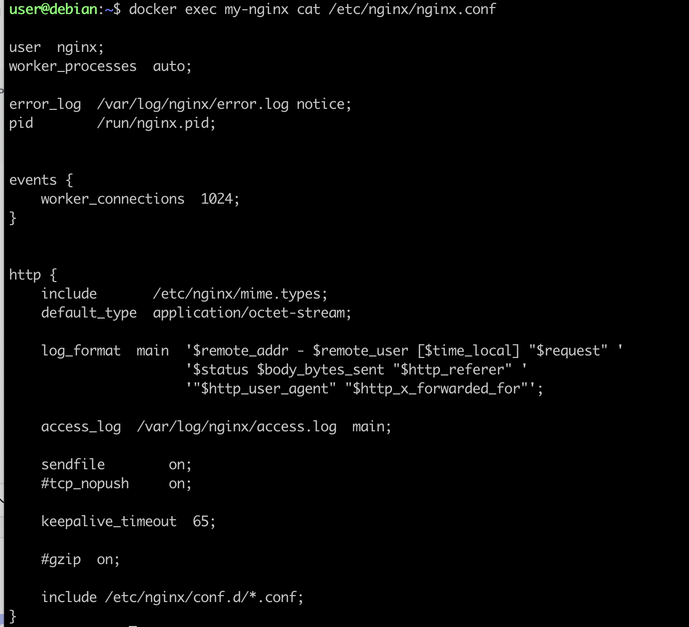
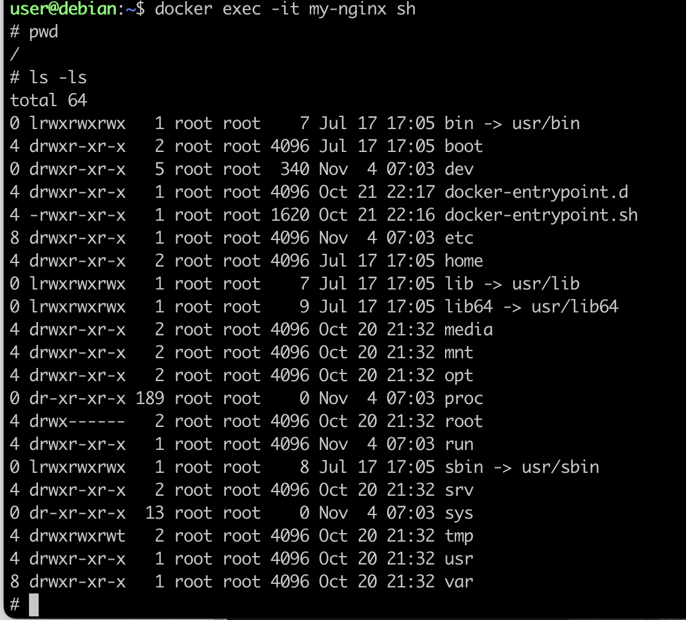
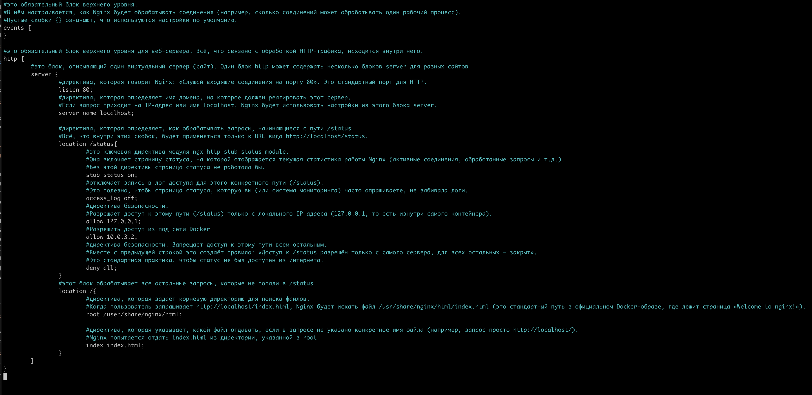
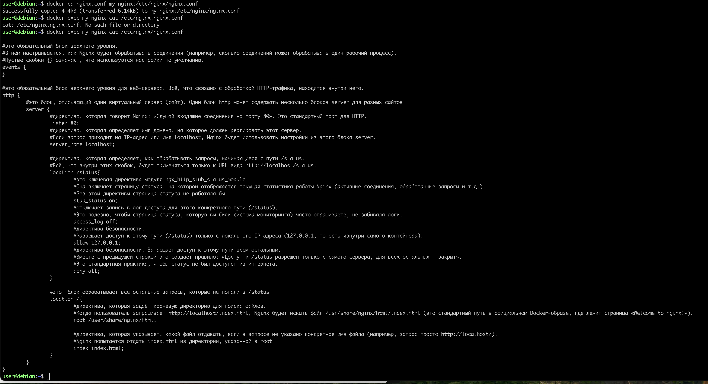
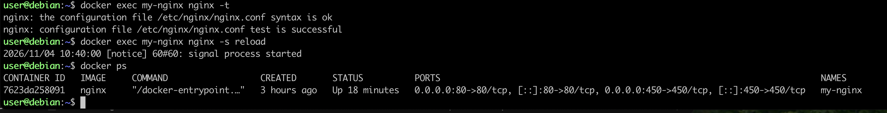
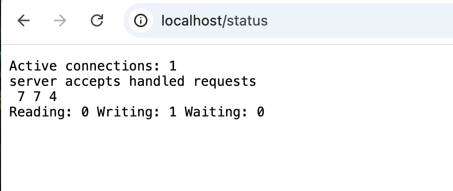
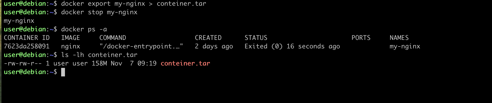
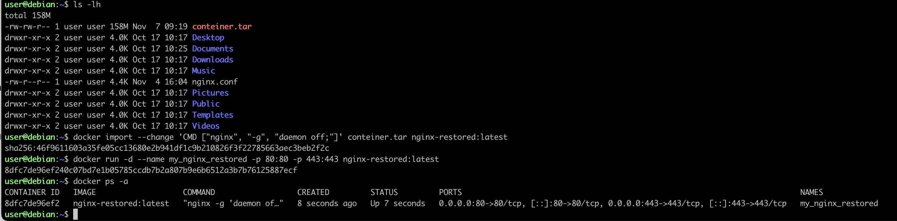

# Операции с контейнером

Мы разобрались с основными командами Docker, теперь покопаемся в конфигурации nginx.

## 1. Прочитай конфигурационный файл nginx.conf внутри докер контейнера через команду exec.
```docker exec <name, id>``` - позволяет выполнить команду внутри уже запущенного контейнера. Это ключевой инструмент для отладки и инспекции: вы не заходите в контейнер по SSH (там его обычно нет), а «прокидываете» нужную команду прямо в его пространство имён.<br>


**Флаг -it** (интерактивный терминал) нужен, если вы хотите зайти в shell (bash/sh) и уже там выполнять команды. Но для простого cat он не обязателен.
 

Создадим на локальной машине файл nginx.conf. А лучше скопируем его с нашего контейнера командой: <br>
```docker cp my-nginx:/etc/nginx/nginx.conf ./nginx.conf```
nginx.conf - этот файл написан на языке конфигурации Nginx. Это не язык разметки (как HTML или XML), а специализированный язык директив и контекстов (блоков). Сам синтаксис очень простой и напоминает конфиги некоторых других демонов. Главные правила:
- Директивы (простые команды) заканчиваются точкой с запятой ;.
- Блоки (контексты) обрамляются фигурными скобками {}. Внутри блока могут быть другие директивы и блоки.
- Комментарии начинаются с решётки # и действуют до конца строки.

Настроим в нем по пути /status отдачу страницы статуса сервера nginx:


Скопируем созданный файл nginx.conf внутрь докер-образа через команду docker cp:


Перезапустим nginx внутри докер-образа через команду exec:
- Прежде чем перезагружать, убедитесь, что в вашем новом nginx.conf нет синтаксических ошибок:
```docker exec my_nginx nginx -t```
Если вывод ```syntax is ok``` и ```test is successful``` — можно перезагружать:
```docker exec my_nginx nginx -s reload```


Проверим, что по адресу localhost:80/status отдается страничка со статусом сервера nginx:


Экспортируем контейнер в файл container.tar через команду export:
```docker export my_nginx > container.tar``` или
```docker export --output=container.tar my_nginx```
Остановим контейнер и проверим, что файл .tar создан ```ls -lh container.tar```

Удалим образ через docker ```docker rmi -f nginx:latest```, не удаляя перед этим контейнеры. Он выдаст ошибку, т.к. наш контейнер ссылается на образ. Если Docker откажется удалять образ из-за ссылки от остановленного контейнера, можно использовать флаг -f (force)
Удалим остановленный контейнер ```docker rm [name, id]```

Импортируем контейнер обратно через команду import:
```docker import --change 'CMD ["nginx", "-g", "daemon off;"]' container.tar [name_restored]```<br>
или через pipe:
```cat container.tar | docker import --change 'CMD ["nginx", "-g", "daemon off;"]' - nginx-restored:latest```
Если не указать --change, при запуске контейнера вы получите ошибку no command specified

Запустим импортированный контейнер:
```docker run -d --name [name] -p 80:80 -p 443:443 [name_restored]```


Проверим, что по адресу localhost:80/status отдается страничка со статусом сервера nginx.
<br>
**Отличие между export/import vs push/pull vs save/load**
- export — снимок файловой системы контейнера в tar. Теряет CMD, ENTRYPOINT, ENV и историю слоёв. Восстановление через import + флаг --change для команды запуска.

- push/pull — передача образа через registry (Docker Hub и др.) со всеми слоями и метаданными.

- save/load — «средний» вариант: tar-файл, но с полным образом (метаданные сохраняются).

**Для nginx при импорте обязателен --change 'CMD ["nginx", "-g", "daemon off;"]', иначе контейнер не стартует.**