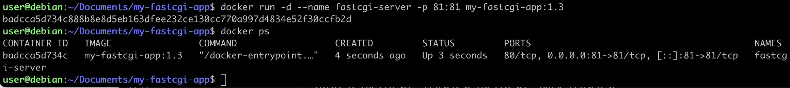
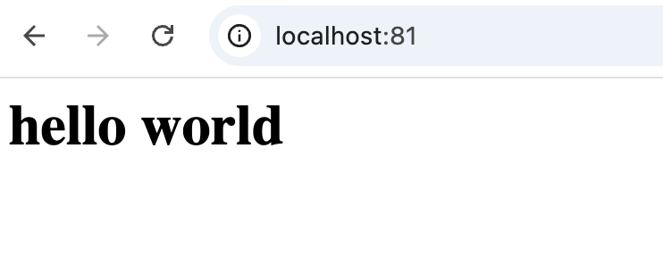

# Мини веб-сервер


1. Напишем мини-сервер на C и FastCgi, который будет возвращать простейшую страничку с надписью Hello World!.
    - FastCGI — протокол для связи веб-сервера (Nginx) и приложения (C-код). Позволяет приложению оставаться в памяти и обрабатывать много запросов подряд.

    - spawn-fcgi — утилита, которая запускает FastCGI-приложение и «привязывает» его к порту (например, 8080).

    - Nginx — принимает HTTP-запросы от браузера на порту 81 и с помощью директивы fastcgi_pass передаёт их приложению на порт 8080.

    - Схема работы: Браузер → Nginx (порт 81) → FastCGI-приложение (порт 8080) → Nginx → Браузер.
2. Запусти написанный мини-сервер через spawn-fcgi на порту 8080.
3. Напиши свой nginx.conf, который будет проксировать все запросы с 81 порта на 127.0.0.1:8080.
4. Проверь, что в браузере по localhost:81 отдается написанная тобой страничка.
5. Положи файл nginx.conf по пути ./nginx/nginx.conf (это понадобится позже).

Сделаем наш сервер в контейнере и соберем все это с помощью Dockerfile.
Создадим директорию и 4 файла в нашей виртуальной машине:<br>
```mkdir my-fastcgi-app```<br>
```cd my-fastcgi-app/```<br>
Все файлы и папки будут лежать в данной директории.
После мы выполним команду: <br>
```docker build -t my-fastcgi-app .```<br>
и запустим контейнер:<br>
```docker run -d --name my-fastcgi-container -p 81:81 my-fastcgi-app```<br>

Чтобы открыть страницу в браузере на вашей локальной машине, не забудьте добавить в настройках VirtualBox правило проброса портов: Порт хоста 81 → Порт гостя 81. После этого в браузере локальной машине перейдите по адресу http://localhost:81
