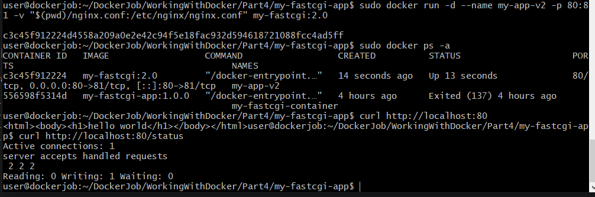

# Свой докер-образ

В Part3 мы уже сделали это задание, но здесь мы немноо его изменим:
1. Допиши в ./nginx/nginx.conf проксирование странички /status, по которой надо отдавать статус сервера nginx.
2. Собираем образ, указав имя и тег (например: my-fastcgi-app:2.0):
``` docker build -t my-fastcgi:2.0 .```
3. Проверим, что образ появился в списке: ```docker images```
4. Замапить 80 порт локальной машины на 81 порт контейнера (-p 80:81). Замапить папку ./nginx внутрь контейнера туда, где лежат конфиги ```-v $(pwd)/nginx/nginx.conf:/etc/nginx/nginx.conf```:
```docker run -d --name my-fastcgi-container-v2 -p 80:81 -v "$(pwd)/nginx.conf:/etc/nginx/nginx.conf" my-fastcgi:2.0```
