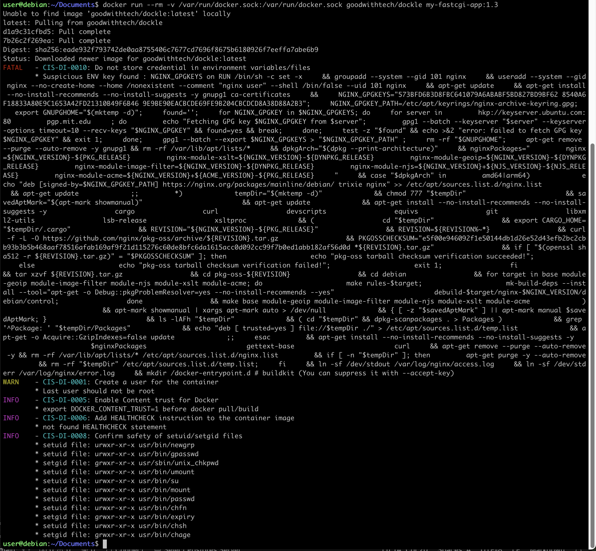

# Dockle

**dockle** — это утилита для проверки (линтинга) Docker-образов на соответствие лучшим практикам безопасности и рекомендациям CIS Docker Benchmark. Если говорить проще, это «аудит безопасности» вашего готового образа, который подсказывает, как сделать его надёжнее и правильнее. Dockle помогает выявить типичные ошибки и небезопасные настройки в готовом образе. 

# Как начать пользоваться.
1. Соберем или возьмем готовый образ, который хотим проверить.
2. Запустим Dockle следующей командой:
```docker run --rm -v /var/run/docker.sock:/var/run/docker.sock goodwithtech/dockle my-java-app:1.0```<br>
    2.1. ```-v /var/run/docker.sock:...``` — даёт Dockle доступ к Docker-демону, чтобы он мог «увидеть» ваш локальный образ.

    2.2. ```my-java-app:1.0``` — имя и тег проверяемого образа.
3. После выполнения вы получите отчёт с найденными проблемами (они будут помечены как FATAL, WARN или INFO) и рекомендациями по их исправлению.

