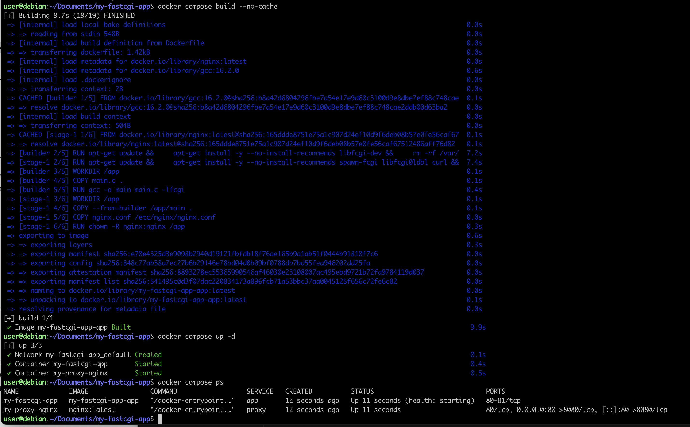

# Базовый Docker Compose.

Напишем файл docker-compose.yml, с помощью которого:
1. Поднимем наш докер-контейнер, написанный на языке С (он должен работать в локальной сети).
2. Поднимем докер-контейнер с nginx, который будет проксировать все запросы с 8080 порта на 81 порт первого контейнера.Создадим новый конфирурационный файл proxy-nginx.conf. 
Замапать 8080 порт второго контейнера на 80 порт локальной машины. Создадим docker-compose.yml.
Соберем и запустим проект с помощью команд docker-compose build и docker-compose up.
Проверь, что в браузере по localhost:80 отдается написанная тобой страничка, как и ранее.


## Какие команды использовали.
- ```docker compose down``` - эта команда полностью останавливает и удаляет все контейнеры, созданные для вашего проекта, а также удаляет внутреннюю сеть Docker, которую Compose создал для их связи.
- ```docker compose build --no-cache``` - собирает Docker-образ на основе вашего Dockerfile. ```--no-cache``` она приказывает Docker'у игнорировать кэш. Docker обычно пытается сэкономить время и берет неизмененные слои из памяти. Этот флаг заставляет его скачать заново все пакеты и, главное, заново скопировать ваши новые файлы конфигурации внутрь образа.
- ```docker compose up -d``` - создает и запускает контейнеры, сети и тома, описанные в docker-compose.yml. Если образов нет, он их сначала соберет (или возьмет готовые). Все делается в фоновом режиме (```-d```).
- ```docker compose ps``` - показывает статус контейнеров